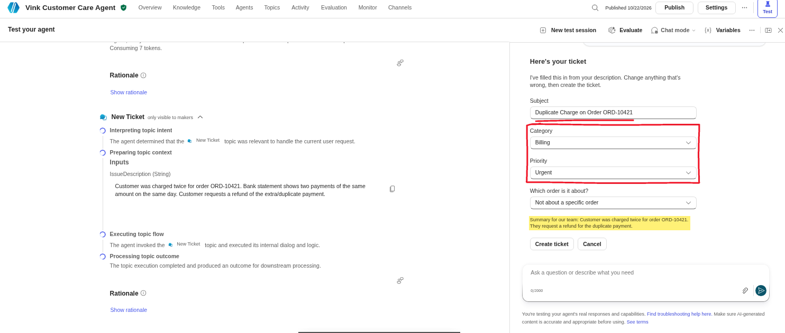
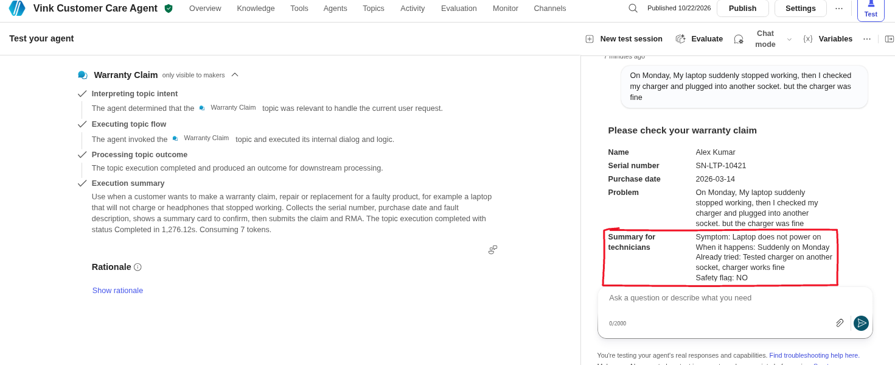
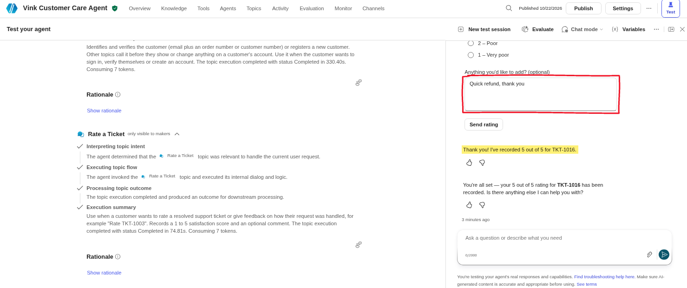
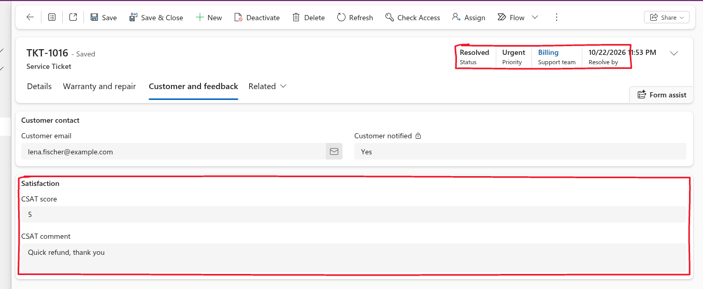
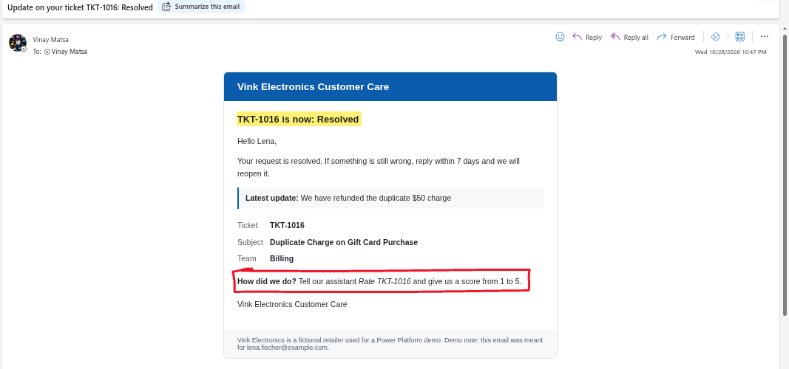
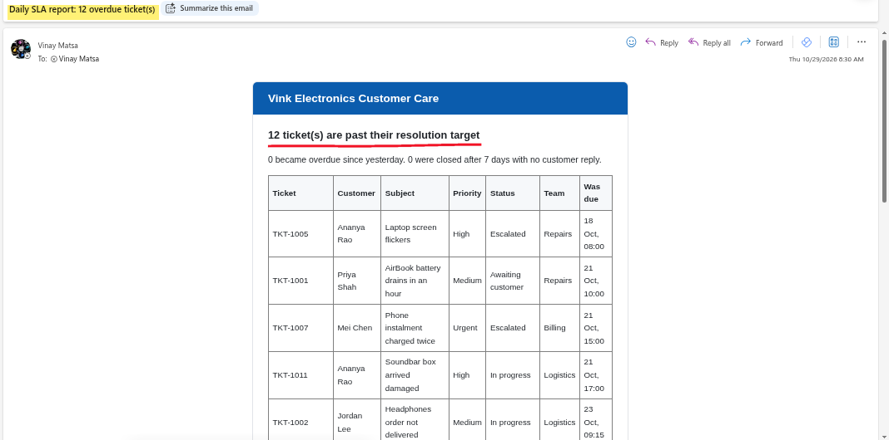
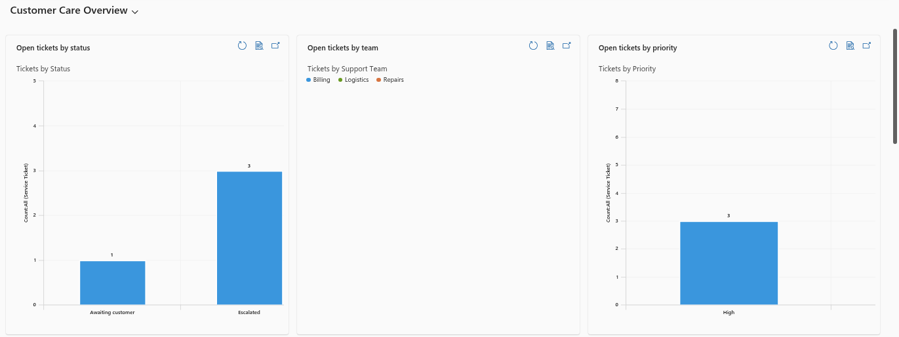
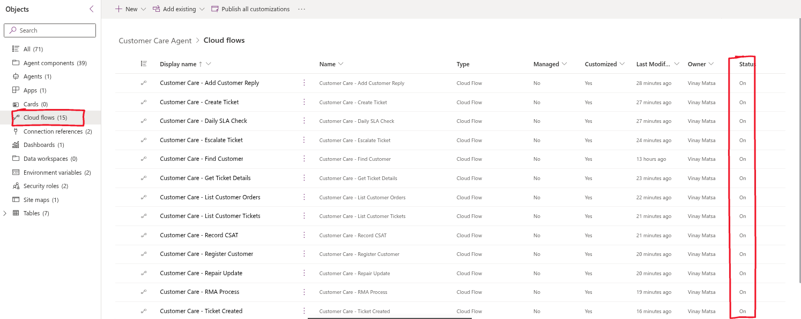

# Vink Customer Care Agent (Microsoft Power Platform)

An end-to-end customer support solution for a fictional electronics retailer, Vink Electronics.

## What it does
- Customers chat with an AI agent (Copilot Studio) to raise tickets, check ticket status, track orders, make warranty claims, escalate to a person and rate their support.
- Verifies customers by email + order number or customer number.
- AI triage suggests category, priority and a summary for each ticket.
- Routes tickets to Repairs, Billing or Logistics with SLA due times; VIP tickets are raised to High.
- Detects duplicate tickets.
- Sends automatic emails for new tickets, status changes and escalations, plus a daily SLA report.
- Autonomous trigger: when a returned item is scanned at the warehouse, the agent updates the ticket on its own.
- Staff app (Vink Care Hub) with views, dashboard, charts and security roles.

## Built with
Copilot Studio · Power Automate · Dataverse · Model-driven Power Apps · AI Builder prompts

## How to install
1. In Power Apps, go to Solutions > Import solution.
2. Select the .zip file in this repository.
3. Set the connections and environment variables when asked.

## Screenshots

### New ticket with AI triage

### Warranty claim

### Customer rates a resolved ticket

### Staff app: ticket form with CSAT

### Automatic status email

### Daily SLA report

### Customer Care Overview dashboard

### Cloud flows in the solution

---
Vink Electronics is fictional and all sample data is made up.
