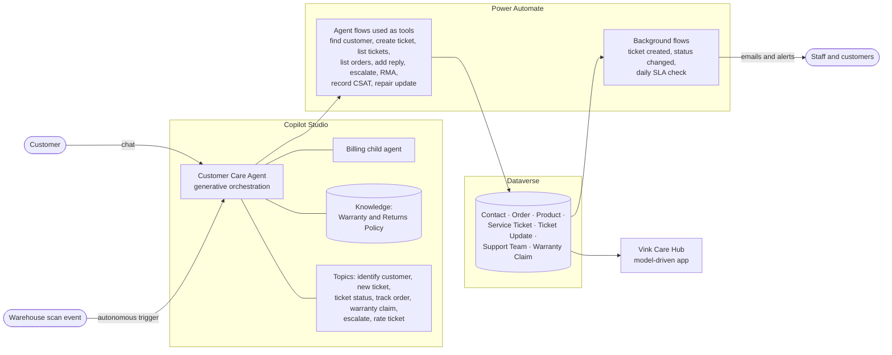
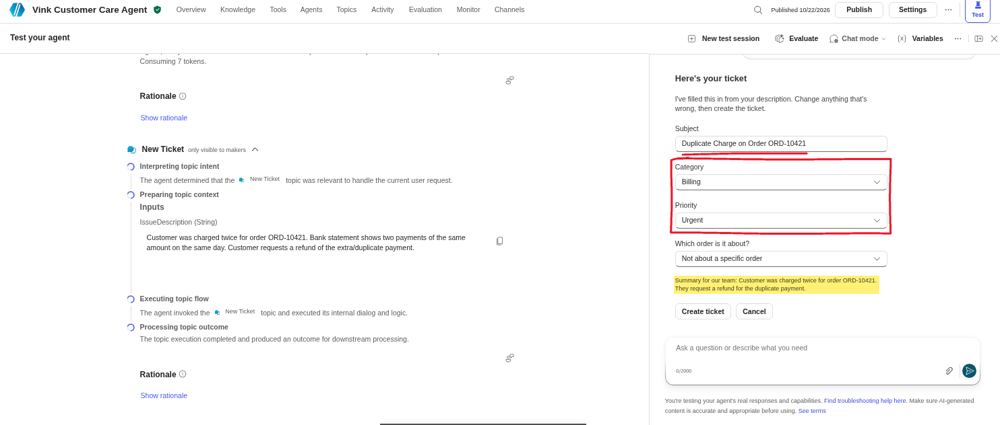
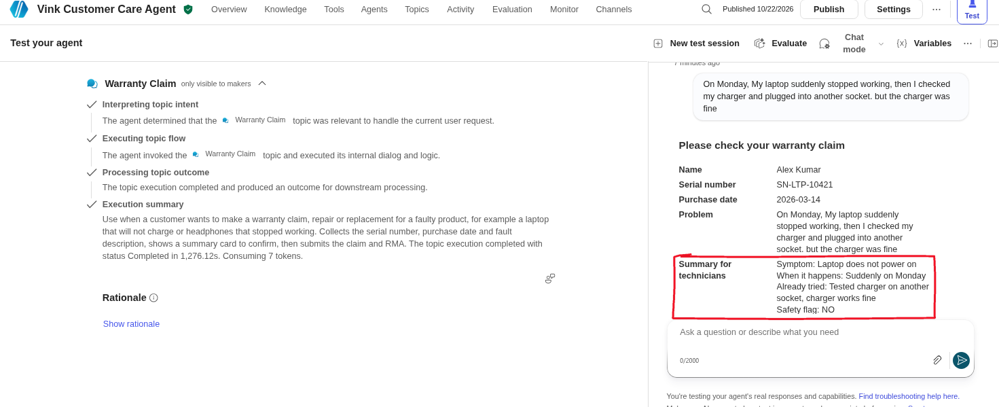
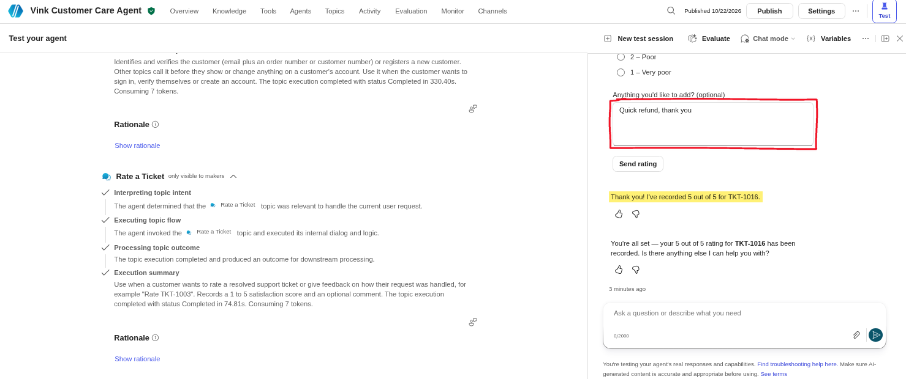
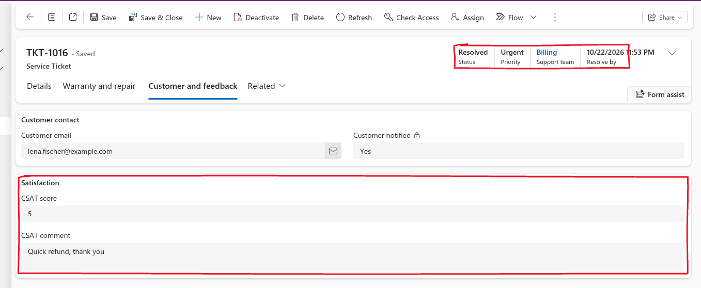
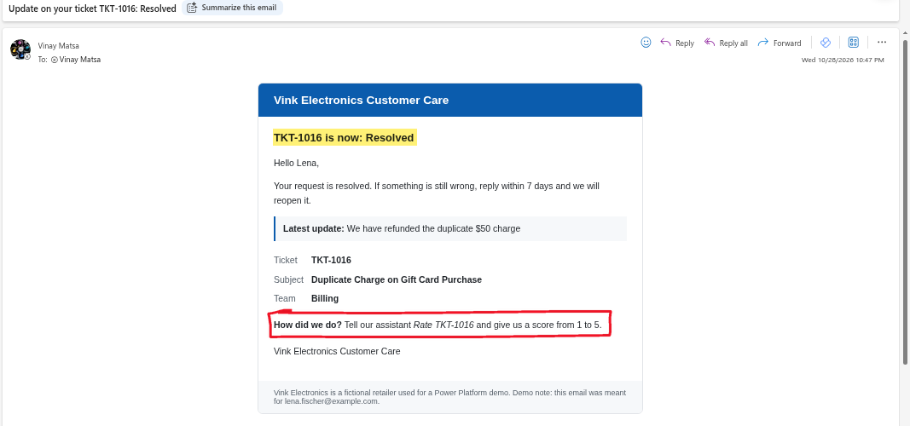
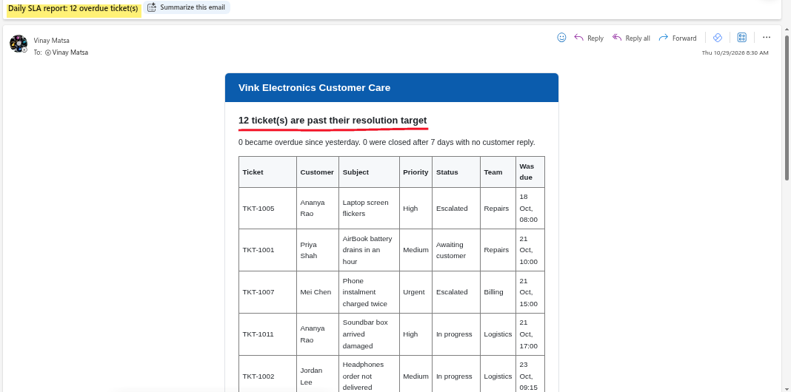
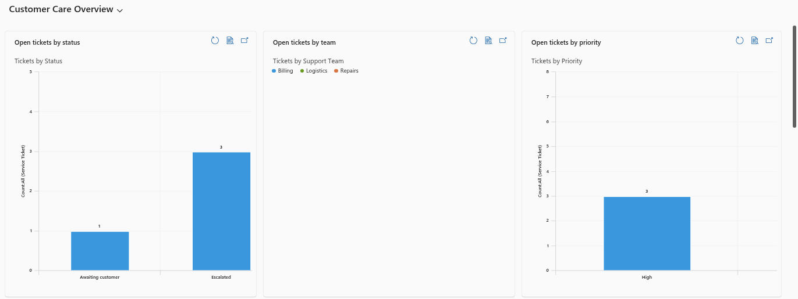
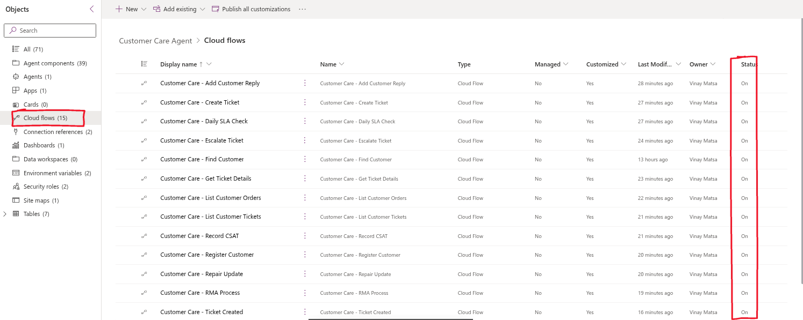

# Vink Customer Care Agent (Microsoft Power Platform)

An end-to-end AI customer support solution for a fictional electronics retailer, **Vink Electronics**, built with **Copilot Studio**, **Power Automate**, **Dataverse** and a **model-driven app**.

> **Personal project.** Built in my own developer environment to practice Copilot Studio and Power Platform skills hands-on. Vink Electronics is fictional and all sample data is made up.

## Architecture

## What it demonstrates

| Area | Implementation |
|---|---|
| Agent design | Copilot Studio agent with generative orchestration, custom topics, entities (order, ticket and serial numbers) and a Billing child agent |
| Grounding | Warranty and Returns Policy as a knowledge source, with rules in the agent instructions |
| Tools | Power Automate agent flows called as tools to read and write Dataverse |
| AI triage | A prompt suggests subject, category, priority and a staff summary; the customer confirms on an adaptive card, and a duplicate check runs before the ticket is created |
| Autonomous trigger | A warehouse scan event makes the agent update the repair ticket with no one in the chat |
| Data model | Dataverse tables for customers, orders, products, tickets, ticket updates (customer-visible vs internal), support teams and warranty claims, with autonumbers and SLA due dates |
| Staff app | Vink Care Hub model-driven app with security roles, views, charts and a dashboard |
| Automation | Status emails, VIP and urgent alerts, and a daily SLA report, with all addresses held in environment variables |
| Responsible AI | Customer verification (email plus order or customer number), human escalation, and instructions never to ask for card numbers, passwords or one-time codes |

## How to install

1. In Power Apps, go to **Solutions > Import solution**.
2. Select `CustomerCareAgent_1_0_0_1.zip` from this repository.
3. Set the connections and the environment variables (`vin_CCSupportMailbox`, `vin_CCCustomerEmailOverride`) when asked.

## Screenshots

### New ticket with AI triage

### Warranty claim

### Customer rates a resolved ticket

### Staff app: ticket form with CSAT

### Automatic status email

### Daily SLA report

### Customer Care Overview dashboard

### Cloud flows in the solution

## Built with

Copilot Studio · Power Automate · Dataverse · Model-driven Power Apps · AI Builder prompts · Adaptive Cards
